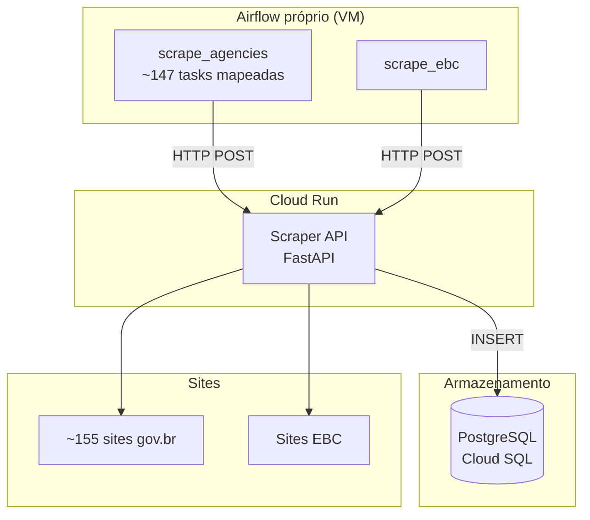

# Módulo: Scraper

!!! info "Repositório"
    **GitHub**: [destaquesgovbr/scraper](https://github.com/destaquesgovbr/scraper)

---

## Visão Geral

O **scraper** é um repositório standalone que coleta notícias de ~155 agências governamentais (gov.br) e da EBC (Agência Brasil, TV Brasil, etc.).

A coleta é orquestrada por **DAGs Airflow** (Airflow próprio na VM `destaquesgovbr-airflow`) que chamam uma **API FastAPI** hospedada no Cloud Run. Os dados são inseridos diretamente no PostgreSQL (insert-only).

```
DAG scrape_agencies (a cada 2 h, 06h–22h BRT; 1 task por agência)
    → HTTP POST para Cloud Run API
        → Scraper faz fetch do site gov.br
            → Parse HTML → Markdown
                → INSERT no PostgreSQL
```

## Arquitetura



## Estrutura do Repositório

```
scraper/
├── src/govbr_scraper/
│   ├── api.py                    # FastAPI (Cloud Run)
│   ├── scrapers/
│   │   ├── webscraper.py         # Scraper gov.br
│   │   ├── scrape_manager.py     # Coordenador gov.br
│   │   ├── ebc_webscraper.py     # Scraper EBC
│   │   ├── ebc_scrape_manager.py # Coordenador EBC
│   │   └── config/
│   │       └── site_urls.yaml    # URLs por agência
│   ├── storage/
│   │   ├── storage_adapter.py
│   │   └── postgres_manager.py
│   └── models/
│       └── news.py               # Modelos Pydantic
├── dags/                          # DAGs Airflow
│   ├── scrape_agencies.py         # 1 DAG, 1 task mapeada por agência
│   ├── scrape_ebc.py              # 1 DAG EBC
│   ├── monitor_scraping_health.py # alertas (Pub/Sub dgb.ops.alerts → Telegram)
│   └── config/
│       └── site_urls.yaml
├── docker/Dockerfile
└── .github/workflows/
    ├── scraper-api-deploy.yaml
    ├── composer-deploy-dags.yaml  # deploy das DAGs no Airflow (nome antigo)
    └── tests.yaml
```

## API Endpoints

A API roda no Cloud Run e é chamada pelas DAGs Airflow.

| Método | Endpoint | Descrição |
|--------|----------|-----------|
| `POST` | `/scrape/agencies` | Raspa sites gov.br (aceita lista de agências, datas) |
| `POST` | `/scrape/ebc` | Raspa sites EBC |
| `GET` | `/health` | Health check |

### Request: `/scrape/agencies`

```json
{
  "start_date": "2025-01-01",
  "end_date": "2025-01-02",
  "agencies": ["mec", "mds"],
  "allow_update": false,
  "sequential": true
}
```

## DAGs Airflow

| DAG | Schedule (BRT) | Descrição |
|-----|----------------|-----------|
| `scrape_agencies` | `0 6-22/2 * * *` (06h–22h, 9x/dia) | 1 task `scrape` mapeada por agência gov.br ativa (~147, sigla no map index) + `summarize` |
| `scrape_ebc` | `0 6-22/2 * * *` | Sites EBC |
| `monitor_scraping_health` | `30 6-22/2 * * *` | Agências sem execução, falhas consecutivas e sem notícias novas |
| `cleanup_old_scrape_runs` | `0 3 * * *` | Retenção do `scrape_runs` (90 dias) |
| `scraper_coverage_report` | `0 8 * * *` | Cobertura das últimas 24 h |

Cada task de scraping:

- Chama a API no Cloud Run via HTTP POST (ID token IAM), no máximo 4 agências ao mesmo tempo
- Retry: 2x a cada 5 min, só para erro passageiro (erro permanente falha sem retry)
- Timeout: 10 min por agência (30 min na EBC)

Até nov/2026 eram ~147 DAGs `scrape_<agencia>`, cada uma a cada 10 min, no Cloud Composer.

→ Veja [Airflow DAGs](../workflows/airflow-dags.md) para detalhes de deploy e configuração.

## Variáveis de Ambiente

```bash
DATABASE_URL=postgresql://...   # PostgreSQL connection string
STORAGE_BACKEND=postgres        # Sempre postgres
LOG_LEVEL=INFO                  # Loguru level
```

## Deploy

| Componente | Destino | Workflow |
|-----------|---------|----------|
| **API** | Cloud Run | `scraper-api-deploy.yaml` |
| **DAGs** | Airflow próprio (`gs://destaquesgovbr-airflow/dags/scraper/`) | `composer-deploy-dags.yaml` (reusable `airflow-deploy-dags.yml@v3`) |

→ Veja [Docker Builds](../workflows/docker-builds.md) para detalhes de build da imagem.

## Desenvolvimento Local

```bash
# Instalar dependências
poetry install

# Rodar testes
poetry run pytest

# Rodar API localmente
poetry run uvicorn govbr_scraper.api:app --reload
```

## Links Relacionados

- **[Data Platform](data-platform.md)** — Enriquecimento, embeddings e indexação (pipeline pós-scraping)
- **[Pipeline de Dados](../workflows/scraper-pipeline.md)** — Visão completa do pipeline scraping + enrichment
- **[PostgreSQL](../arquitetura/postgresql.md)** — Banco de dados central
