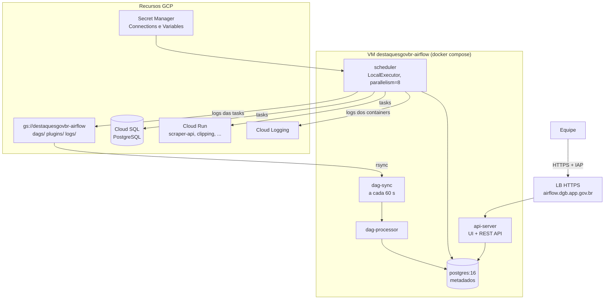
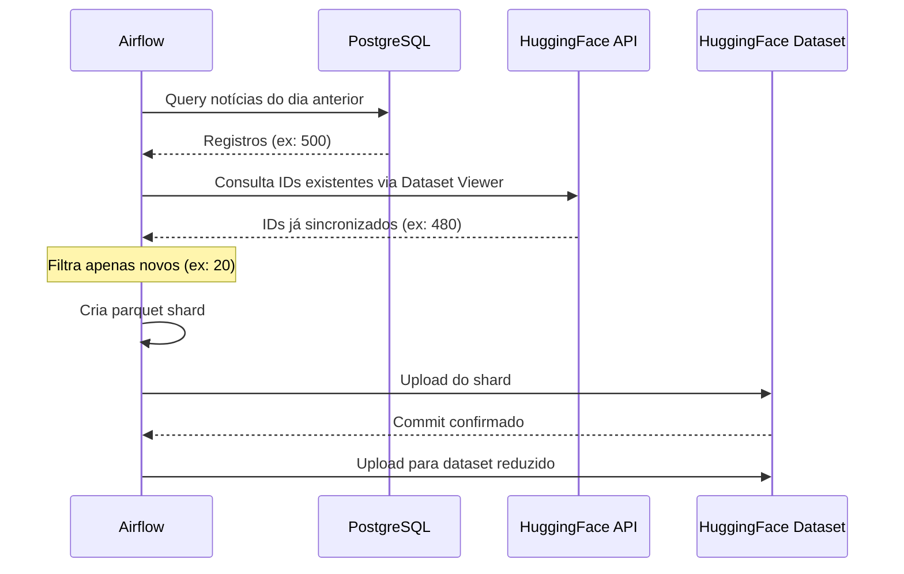
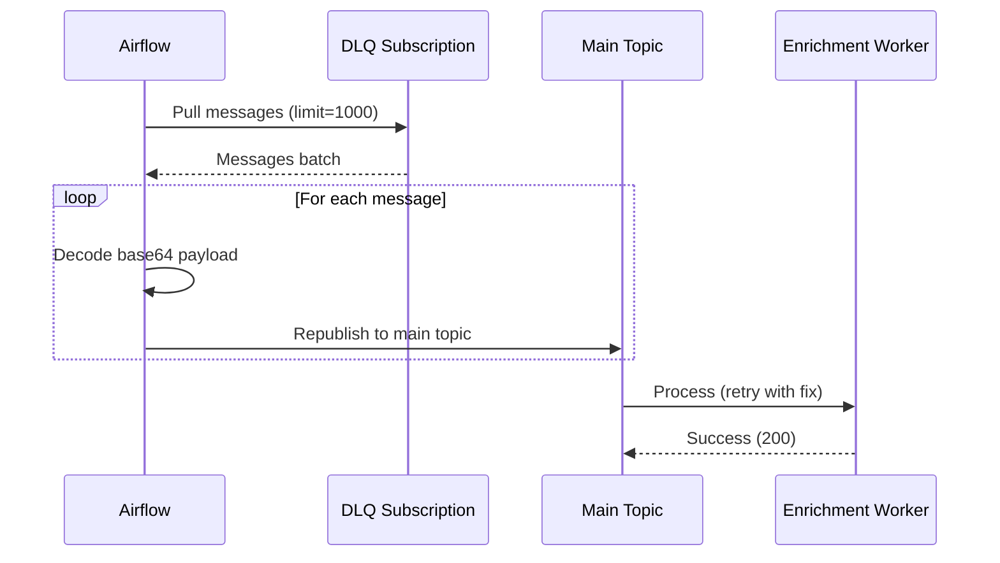
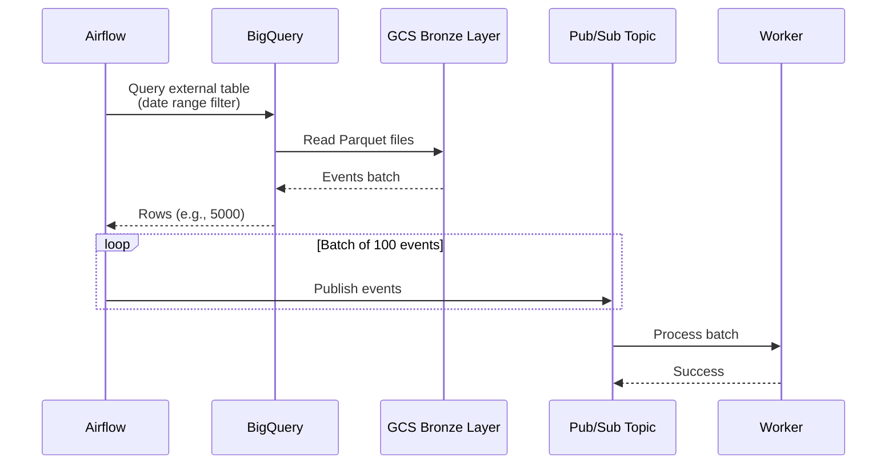

# Airflow DAGs (Airflow próprio)

O projeto usa um **Apache Airflow 3.1 próprio**, em docker compose numa VM do Compute Engine, para orquestrar os pipelines batch:

- scraping de notícias (repo `scraper`);
- trending, clusters, grafo de entidades, backfills e syncs para o BigQuery (repo `data-platform`);
- envio de clippings (repo `clipping`);
- sync para o HuggingFace (repo `data-publishing`).

!!! info "Airflow próprio (desde 18/11/2026)"
    **VM**: `destaquesgovbr-airflow` (e2-standard-2, Debian 12, sem IP público), zona `southamerica-east1-a`<br/>
    **Versão**: Airflow 3.1.8 (Python 3.11), LocalExecutor<br/>
    **UI**: [https://airflow.dgb.app.gov.br](https://airflow.dgb.app.gov.br), atrás de um LB HTTPS com IAP<br/>
    **Infra**: Terraform no repo `infra` (`terraform/airflow*.tf`, `terraform/templates/airflow/`, imagem em `infra/airflow/`)

!!! note "Cloud Composer desligado"
    Até nov/2026 o projeto usava o **Cloud Composer 3** (`destaquesgovbr-composer`). A troca pelo Airflow próprio economiza cerca de US$ 625/mês. Ela foi feita junto com a troca das ~147 DAGs `scrape_<agencia>`, de 10 em 10 min, por uma DAG só, a cada 2 h. O Composer foi desligado em 18/11/2026. Plano completo: `infra/_plan/migrar-composer-para-airflow-proprio.md`.

## Arquitetura



- **Sem triggerer**: nenhuma DAG é deferrable.
- **SA da VM**: `destaquesgovbr-composer`, a mesma do Composer, que já tinha os papéis de que as DAGs precisam (`run.invoker` nos serviços, BigQuery, Secret Manager, GCS, Pub/Sub). O nome ficou o antigo.
- **Dentro do Airflow**: `SimpleAuthManager` com todos como admin. O IAP do LB é a única porta de entrada.
- **GitOps**: o Terraform entrega o compose, o env e o startup-script pelo metadata da VM, e a unit `airflow-reconcile` reaplica quando algum deles muda. Nada se configura por SSH.

## Organização de DAGs no Bucket

Cada repo publica suas DAGs numa subpasta de `gs://destaquesgovbr-airflow/dags/`, e o container `dag-sync` espelha o bucket na VM a cada 60 s:

```
gs://destaquesgovbr-airflow/
├── dags/
│   ├── clipping/                     # repo clipping
│   │   └── dispatch_clippings.py
│   ├── data-platform/                # repo data-platform (12 DAGs)
│   ├── data-publishing/              # repo data-publishing
│   │   └── sync_postgres_to_huggingface.py
│   ├── platform/                     # repo infra
│   │   └── airflow_heartbeat.py
│   └── scraper/                      # repo scraper
│       ├── scrape_agencies.py        # 1 DAG, 1 task mapeada por agência
│       ├── scrape_ebc.py
│       ├── monitor_scraping_health.py
│       ├── cleanup_old_scrape_runs.py
│       ├── scraper_coverage_report.py
│       ├── notify.py
│       └── config/site_urls.yaml
├── plugins/                          # pacotes importados pelas DAGs
│   ├── data_platform/
│   ├── data_publishing/
│   └── pyphen/
└── logs/                             # logs das tasks (30 dias)
```

## DAGs Disponíveis

Os crons usam o fuso padrão do Airflow, `America/Sao_Paulo` (BRT).

!!! warning "Pendência da virada: 5 DAGs ainda pausadas na VM"
    Em 18/11/2026, `sync_pg_to_bigquery`, `sync_umami_to_bigquery`, `canonicalize_backfill`, `ner_backfill` e `enrichment_backfill` ficaram **pausadas** na VM e ainda não rodaram lá. Não foi decisão: no Composer as cinco rodaram até 18/11, e a virada despausou as demais DAGs, mas não estas. Enquanto estiverem pausadas, o `fato_noticias` do BigQuery não recebe as notícias novas (o `compute_trending` lê dele), o Umami não chega ao BigQuery e os backfills param.

    Para despausar (muda estado, com confirmação de quem opera): `sudo docker exec airflow-airflow-scheduler-1 airflow dags unpause <dag_id>` na VM. Despausadas, apague este aviso e a marca "pausada" da tabela.

| Repo | DAG | Schedule (BRT) | O que faz |
|------|-----|----------------|-----------|
| `scraper` | `scrape_agencies` | `0 6-22/2 * * *` | Raspa as agências gov.br ativas, uma task mapeada por agência |
| `scraper` | `scrape_ebc` | `0 6-22/2 * * *` | Raspa Agência Brasil e TV Brasil |
| `scraper` | `monitor_scraping_health` | `30 6-22/2 * * *` | Agências sem execução, falhas consecutivas e sem notícias novas |
| `scraper` | `cleanup_old_scrape_runs` | `0 3 * * *` | Retenção do `scrape_runs` (90 dias) |
| `scraper` | `scraper_coverage_report` | `0 8 * * *` | Cobertura das últimas 24 h |
| `clipping` | `dispatch_clippings` | `*/10 * * * *` | Agenda os clippings que vencem (`POST /dispatch/schedule`) |
| `data-publishing` | `sync_postgres_to_huggingface` | `0 6 * * *` | Sync incremental para o HuggingFace |
| `data-platform` | `verify_news_integrity` | `*/30 * * * *` | Integridade de imagens e conteúdo |
| `data-platform` | `compute_trending` | `0 */6 * * *` | Trending das notícias (BigQuery → PG) |
| `data-platform` | `compute_entity_trending` | `0 */6 * * *` | Trending das entidades NER |
| `data-platform` | `project_entity_graph` | `0 */6 * * *` | `news_entities` e `entity_edges` |
| `data-platform` | `generate_video_thumbnails` | `0 */4 * * *` | Thumbnails de notícias de vídeo |
| `data-platform` | `compute_clusters` | `30 7 * * *` | Notícias similares (pgvector) |
| `data-platform` | `aggregate_engagement` | `0 8 * * *` | Pageviews do portal → `news_features` |
| `data-platform` | `sync_pg_to_bigquery` | `0 7 * * *` (**pausada**, ver aviso) | PostgreSQL → BigQuery (`fato_noticias` e dimensões) |
| `data-platform` | `sync_umami_to_bigquery` | `0 9 * * *` (**pausada**, ver aviso) | Umami → BigQuery |
| `data-platform` | `canonicalize_backfill` | `0 */6 * * *` (**pausada**, ver aviso) | Backfill da canonicalização de entidades via Cloud Run Job, sob governador de cota |
| `data-platform` | `ner_backfill` | `0 2-23/6 * * *` (**pausada**, ver aviso) | Backfill do NER histórico via Cloud Run Job, sob governador de cota |
| `data-platform` | `enrichment_backfill` | `30 1,4,22 * * *` (**pausada**, ver aviso) | Backfills de enriquecimento (tema, resumo, sentimento) via Cloud Run Job |
| `infra` | `airflow_heartbeat` | `*/15 * * * *` | Grava um heartbeat no Cloud Logging. Sem heartbeat por 45 min, o alerta "Airflow sem heartbeat" vai para o Telegram |

### DAGs do Scraper (repo `scraper`)

#### `scrape_agencies`

Uma DAG só para todas as agências gov.br. Até nov/2026 eram ~147 DAGs `scrape_<agencia>`, cada uma a cada 10 min. Elas eram 96,7% das execuções de task do Composer.

| Configuração | Valor |
|--------------|-------|
| **Schedule** | `0 6-22/2 * * *` (06h às 22h BRT, 9 execuções por dia) |
| **Tasks** | `scrape`, mapeada por agência ativa do `site_urls.yaml` (map index = sigla), mais a `summarize` |
| **Concorrência** | 4 agências ao mesmo tempo (`SCRAPE_MAX_CONCURRENT_AGENCIES`); ~4 a 5 min por execução |
| **Catchup / max_active_runs** | Desabilitado / 1 |
| **Retries** | 2, a cada 5 min, só para erro passageiro. Erro permanente (`html_changed`, `url_broken`, `access_denied`, `anti_bot`) falha sem retry |
| **Timeout** | 10 min por agência |
| **Janela** | 9 h antes da execução. A das 06h cobre a madrugada. Params `start_date`/`end_date` servem para recuperação |

Cada task mapeada faz HTTP POST para a Scraper API no Cloud Run (`POST /scrape/agencies` com uma agência), autenticada com ID token. A `summarize` só falha a execução se nenhuma agência funcionou ou se a fração de falhas passou de `scraper_max_failed_ratio` (padrão 10%). Uma agência quebrada fica vermelha só na task mapeada dela.

#### `scrape_ebc`

DAG para scraping dos sites EBC (Agência Brasil, TV Brasil). Usa a mesma agenda, a mesma janela e os mesmos params da `scrape_agencies`, com timeout de 30 min. Faz HTTP POST para `POST /scrape/ebc` no Cloud Run.

→ Veja [Módulo Scraper](../modulos/scraper.md) para detalhes da API e do repo, e o [runbook do scraper](https://github.com/destaquesgovbr/scraper/blob/main/docs/runbook.md) para diagnóstico e recuperação.

### DAGs do Data Publishing (repo `data-publishing`)

#### `sync_postgres_to_huggingface`

Sincroniza notícias do PostgreSQL para o HuggingFace diariamente.

| Configuração | Valor |
|--------------|-------|
| **Schedule** | `0 6 * * *` (06h BRT) |
| **Catchup** | Desabilitado |
| **Retries** | 3 (com backoff exponencial) |
| **Tags** | `sync`, `huggingface`, `postgres`, `daily` |

Os módulos `data_publishing.hf` são publicados como plugin em `gs://destaquesgovbr-airflow/plugins/data_publishing/`.

#### Fluxo de Execução



#### Abordagem Incremental

A DAG utiliza uma abordagem de **append incremental via parquet shards** para evitar problemas de memória:

1. **Consulta IDs existentes** via Dataset Viewer API (sem baixar o dataset completo)
2. **Cria parquet shard** apenas com novos registros
3. **Upload direto** via `huggingface_hub`

**Vantagens**:
- Memória: ~10MB (apenas novos registros) vs ~1-2GB (dataset completo)
- Deduplicação automática
- Commits atômicos por dia

#### Estrutura do Shard

```
data/train-{YYYY-MM-DD}-{HHMMSS}.parquet
```

Exemplo: `data/train-2025-01-10-060532.parquet`

#### Colunas Sincronizadas

```python
HF_COLUMNS = [
    "unique_id", "agency", "published_at", "updated_datetime", "extracted_at",
    "title", "subtitle", "editorial_lead", "url", "content",
    "image", "video_url", "category", "tags",
    "theme_1_level_1", "theme_1_level_1_code", "theme_1_level_1_label",
    "theme_1_level_2_code", "theme_1_level_2_label",
    "theme_1_level_3_code", "theme_1_level_3_label",
    "most_specific_theme_code", "most_specific_theme_label",
    "summary"
]
```

#### Datasets Atualizados

| Dataset | Colunas | Uso |
|---------|---------|-----|
| `nitaibezerra/govbrnews` | Todas (24) | Análise completa |
| `nitaibezerra/govbrnews-reduced` | 4 (published_at, agency, title, url) | Listagens rápidas |

### DAGs do Data Science (repo `data-science`)

!!! warning "Não publicadas no Airflow de produção"
    As DAGs abaixo existem no repo `data-science`, mas não estão no bucket `gs://destaquesgovbr-airflow`, que só tem `clipping`, `data-platform`, `data-publishing`, `platform` e `scraper`. Para usá-las, publique antes a pasta `dags/data-science/`.

#### `reconciliation_dlq`

Reconcilia mensagens na Dead-Letter Queue após correção de bugs.

| Configuração | Valor |
|--------------|-------|
| **Schedule** | Manual (`None`) |
| **Catchup** | Desabilitado |
| **Retries** | 1 (com backoff de 5 min) |
| **Tags** | `reconciliation`, `pubsub`, `dlq` |

#### Fluxo de Execução



**Uso**: Trigger manual após correção de bugs no worker para reprocessar mensagens falhadas.

→ Veja [Dead-Letter Queue Guide](./pub-sub-deadletter.md) para detalhes de DLQ management.

#### `replay_bronze_events`

Reprocessa eventos da Bronze Layer (GCS Parquet) para Silver Layer (PostgreSQL).

| Configuração | Valor |
|--------------|-------|
| **Schedule** | Manual (`None`) |
| **Catchup** | Desabilitado |
| **Retries** | 2 (com backoff exponencial) |
| **Tags** | `replay`, `bronze`, `recovery` |
| **Parameters** | `start_date`, `end_date`, `topic` |

#### Fluxo de Execução



**Cenários de Uso**:

1. **Perda de dados na Silver Layer**: Reprocessar eventos de um período específico
2. **Correção de lógica de enriquecimento**: Reprocessar com nova versão do worker
3. **Backfill**: Processar dados históricos com novos workers

→ Veja [Bronze Layer GCS](../modulos/bronze-layer-gcs.md) para detalhes da arquitetura Bronze.

## Configuração do Airflow próprio

### VM e containers

| Item | Valor |
|------|-------|
| VM | e2-standard-2 (2 vCPU, 8 GB) sob demanda, swap de 2 GB, sem IP público |
| Discos | Boot de 30 GB e disco de dados de 20 GB (pd-balanced) para o Postgres de metadados. O disco de dados tem `prevent_destroy`, snapshot diário e 7 dias de retenção |
| Rede | `destaquesgovbr-subnet` com Private Google Access e Cloud NAT. Cloud SQL pelo IP privado |
| Containers | `postgres` (16), `airflow-init` (`airflow db migrate`), `airflow-apiserver`, `airflow-scheduler`, `airflow-dag-processor`, `dag-sync` |
| Imagem | `infra/airflow/Dockerfile` (`apache/airflow:3.1.8-python3.11` + `requirements.txt` com constraints), publicada no Artifact Registry `destaquesgovbr-airflow` pelo workflow `airflow-image.yml` |
| Manutenção | Timer semanal `airflow db clean` (30 dias). Ops Agent com alertas de memória e disco |

**Trocar a imagem** (pacote novo para uma DAG ou upgrade do Airflow) é um PR no `infra` que muda `airflow_image_tag`. O `airflow-reconcile` aplica o novo compose, e o `airflow-init` migra o banco antes dos outros containers subirem.

### Configuração do Airflow

Valores do `terraform/templates/airflow/airflow.env.tftpl`:

```bash
AIRFLOW__CORE__EXECUTOR=LocalExecutor
AIRFLOW__CORE__PARALLELISM=8
AIRFLOW__CORE__DEFAULT_TIMEZONE=America/Sao_Paulo   # todos os crons em BRT
AIRFLOW__CORE__LOAD_EXAMPLES=False
AIRFLOW__CORE__DAGS_ARE_PAUSED_AT_CREATION=True
AIRFLOW__DAG_PROCESSOR__REFRESH_INTERVAL=60          # arquivo novo entra em até ~2 min
AIRFLOW__DAG_PROCESSOR__MIN_FILE_PROCESS_INTERVAL=180 # mudança numa DAG: até ~4 min
AIRFLOW__CORE__AUTH_MANAGER=...SimpleAuthManager     # IAP é a única porta de entrada
AIRFLOW__CORE__SIMPLE_AUTH_MANAGER_ALL_ADMINS=True
AIRFLOW__LOGGING__REMOTE_LOGGING=True
AIRFLOW__LOGGING__REMOTE_BASE_LOG_FOLDER=gs://destaquesgovbr-airflow/logs
# Lidas pelas DAGs no parse
GCP_PROJECT_ID, GCP_REGION, POSTGRES_HOST/PORT/DB, TYPESENSE_HOST/PORT, CANON_MODEL_ID
```

O secrets backend é o mesmo do Composer: `CloudSecretManagerBackend`, com os prefixos `airflow-connections` e `airflow-variables`.

## Connections e Variables

As Connections e Variables vêm do **Secret Manager**. Variable que não está lá é lida do metastore. Exemplos:

| Tipo | Nome | Secret |
|------|------|--------|
| Connection | `postgres_default` | `airflow-connections-postgres_default` |
| Connection | `huggingface_default` | `airflow-connections-huggingface_default` |
| Variable | `scraper_api_url` | `airflow-variables-scraper_api_url` |
| Variable | `clipping_service_url` | `airflow-variables-clipping_service_url` |
| Variable | `typesense_api_key` | `airflow-variables-typesense_api_key` |

## Deploy de DAGs

### Via GitHub Actions

Os repos de DAG (`scraper`, `clipping`, `data-publishing` e `data-platform`) chamam a reusable `destaquesgovbr/reusable-workflows/.github/workflows/airflow-deploy-dags.yml@v3` no push para a `main`. Ela:

1. valida as DAGs com o Airflow 3.1.8 (o da imagem da VM), instalado com o arquivo de constraints;
2. sincroniza a pasta de DAGs em `gs://destaquesgovbr-airflow/dags/<repo>/` (e, se houver, o pacote de plugins em `plugins/<pacote>/`) com `gcloud storage rsync --delete-unmatched-destination-objects`.

No `scraper`, no `clipping` e no `data-publishing`, a lista de buckets é o default da reusable. O `data-platform` define a sua (`AIRFLOW_DAG_BUCKETS`) porque publica os plugins num job próprio, antes das DAGs.

```yaml
jobs:
  deploy:
    uses: destaquesgovbr/reusable-workflows/.github/workflows/airflow-deploy-dags.yml@v3
    with:
      dags_local_path: dags
      dags_bucket_subdir: scraper
```

Na VM, o `dag-sync` copia o bucket a cada 60 s. Uma DAG nova aparece em até ~2 min, e a mudança numa DAG existente vale em até ~4 min.

### Manual (só se o workflow estiver indisponível)

```bash
gcloud storage rsync --project=inspire-7-finep --recursive --delete-unmatched-destination-objects \
  dags/ gs://destaquesgovbr-airflow/dags/scraper/
```

## Monitoramento

### Web UI

[https://airflow.dgb.app.gov.br](https://airflow.dgb.app.gov.br), pelo IAP, com conta Google da equipe (grupo `dev-team-inspire7`). Não há segundo login dentro do Airflow.

### CLI e banco de metadados (SSH via IAP)

A VM não tem IP público. A CLI do Airflow roda no container do scheduler:

```bash
gcloud compute ssh destaquesgovbr-airflow --zone=southamerica-east1-a \
  --project=inspire-7-finep --tunnel-through-iap

# na VM
sudo docker exec airflow-airflow-scheduler-1 airflow dags list-runs scrape_agencies -o plain
sudo docker exec airflow-airflow-scheduler-1 airflow dags list-import-errors

# banco de metadados, somente leitura
sudo docker exec -i -e PGOPTIONS='-c default_transaction_read_only=on' airflow-postgres-1 \
  sh -c 'psql -U "$POSTGRES_USER" -d "$POSTGRES_DB"'
```

### Logs

- **Tasks**: no GCS (30 dias), legíveis sem SSH:
  ```bash
  gcloud storage cat --project=inspire-7-finep \
    "gs://destaquesgovbr-airflow/logs/dag_id=scrape_agencies/run_id=<run_id>/task_id=scrape/map_index=<N>/attempt=1.log"
  ```
- **Containers** (scheduler, dag-processor, api-server): Cloud Logging, log `gcplogs-docker-driver` (recurso `gce_instance`):
  ```bash
  gcloud logging read 'logName="projects/inspire-7-finep/logs/gcplogs-docker-driver"
    AND jsonPayload.container.name="/airflow-airflow-scheduler-1"' \
    --project=inspire-7-finep --freshness=1h --limit=20 --format='value(timestamp,jsonPayload.message)'
  ```

### Alertas

| Alerta | Origem | O que pega |
|--------|--------|------------|
| Airflow sem heartbeat | DAG `airflow_heartbeat` + métrica de log (ausência por 45 min) | VM parada, scheduler morto, executor travado |
| Memória e disco da VM | Ops Agent | Falta de memória ou disco cheio |
| Saúde do scraping | `monitor_scraping_health` → Pub/Sub `dgb.ops.alerts` → Telegram | Agências sem execução, falhas consecutivas, sem notícias novas |

## Troubleshooting

### DAG não aparece na UI

1. Verificar se o arquivo está no bucket:
   ```bash
   gcloud storage ls --project=inspire-7-finep gs://destaquesgovbr-airflow/dags/<repo>/
   ```
2. Esperar até ~2 min (60 s do `dag-sync` + refresh do bundle) e procurar import errors na UI ou com `airflow dags list-import-errors` na VM.
3. Pacote ausente na imagem: adicionar em `infra/airflow/requirements.txt` e trocar `airflow_image_tag`.
4. DAG nova nasce **pausada** (`dags_are_paused_at_creation`): despausar na UI.

### Erro de conexão com PostgreSQL

1. Verificar se a connection ou a Variable existe no Secret Manager.
2. Testar de dentro do scheduler (a VM chega ao Cloud SQL pelo IP privado).

### Agências sem execução ou DagRun preso

Ver o [runbook do scraper](https://github.com/destaquesgovbr/scraper/blob/main/docs/runbook.md), seção "Agências Sem Execução", que cobre a CLI na VM e o DagRun zumbi. A skill `/analisar-dags-scraper` (repo `project`) gera um diagnóstico somente leitura.

## Custos Estimados

| Componente | Custo/mês |
|------------|-----------|
| VM e2-standard-2 sob demanda | ~US$ 78 |
| Discos (boot 30 GB + dados 20 GB) | ~US$ 7,5 |
| LB HTTPS (forwarding rule) | ~US$ 18–25 |
| Snapshots, Cloud NAT e GCS | ~US$ 3 |
| **Total** | **~US$ 106–113** |

No Composer, o custo era de ~US$ 738/mês.
