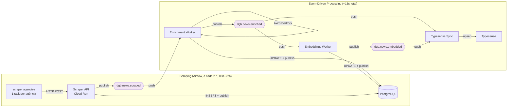
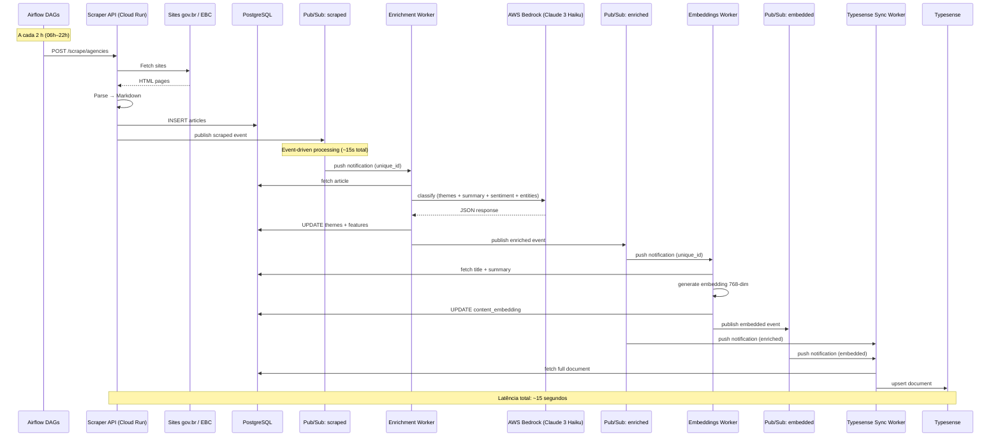

# Workflow: Pipeline de Coleta e Enriquecimento

> Pipeline completo de coleta de notícias (scraper) e enriquecimento event-driven.

!!! note "Arquitetura Atualizada (27/02/2026)"
    Pipeline migrado para **event-driven** com AWS Bedrock. Cogfy e GitHub Actions batch descontinuados.

## Visão Geral

O pipeline é baseado em **arquitetura event-driven** com Cloud Pub/Sub:

1. **Scraping** (repo `scraper`): Via Airflow (DAG `scrape_agencies`), a cada 2 horas das 06h às 22h → publica eventos
2. **Enrichment** (repo `data-science`): Via Enrichment Worker (Cloud Run) → event-driven
3. **Embeddings** (repo `embeddings`): Via Embeddings Worker (Cloud Run) → event-driven
4. **Indexação**: Via Typesense Sync Worker (Cloud Run) → event-driven



---

## Estágio 1: Scraping (Airflow)

**Repositório**: [destaquesgovbr/scraper](https://github.com/destaquesgovbr/scraper)

### Como funciona

- Uma DAG, `scrape_agencies`, com uma task mapeada por agência gov.br ativa (~147, a sigla é o map index), mais a DAG `scrape_ebc`
- As duas rodam a cada **2 horas, das 06h às 22h** (BRT, 9 execuções por dia), no Airflow próprio da VM `destaquesgovbr-airflow`
- Cada task faz HTTP POST para a Scraper API no Cloud Run, com no máximo 4 agências ao mesmo tempo
- A API raspa o site, parseia HTML → Markdown, e insere no PostgreSQL
- Até nov/2026 eram ~147 DAGs `scrape_<agencia>`, cada uma a cada 10 min, no Cloud Composer

### DAGs

| DAG | Schedule (BRT) | Descrição |
|-----|----------|-----------|
| `scrape_agencies` | `0 6-22/2 * * *` | Raspa as agências gov.br ativas (task `scrape` mapeada por agência + `summarize`) |
| `scrape_ebc` | `0 6-22/2 * * *` | Raspa sites EBC |
| `monitor_scraping_health` | `30 6-22/2 * * *` | Alerta agências sem execução, com falhas consecutivas ou sem notícias novas |

### API Endpoints

| Método | Endpoint | Descrição |
|--------|----------|-----------|
| `POST` | `/scrape/agencies` | Raspa sites gov.br |
| `POST` | `/scrape/ebc` | Raspa sites EBC |
| `GET` | `/health` | Health check |

### Deploy

| Componente | Destino | Workflow |
|-----------|---------|----------|
| API | Cloud Run | `scraper-api-deploy.yaml` |
| DAGs | `gs://destaquesgovbr-airflow/dags/scraper/` (reusable `airflow-deploy-dags.yml@v3`) | `composer-deploy-dags.yaml` |

### Config Sync: site_urls.yaml (Dual YAML)

**Problema**: O arquivo `site_urls.yaml` existe em **dois locais** que devem ser mantidos sincronizados:

1. **`src/govbr_scraper/scrapers/config/site_urls.yaml`** (fonte) - Usado pela API Cloud Run
2. **`dags/config/site_urls.yaml`** (cópia) - Usado pelas DAGs Airflow

**Por que dois arquivos?**
- DAGs do Airflow são autocontidas e não importam código Python da API
- API Cloud Run empacota o arquivo de `src/` na imagem Docker
- Mantém separação de responsabilidades entre orquestração (DAGs) e execução (API)

**Como modificar configuração de agências**:

```bash
# 1. Sempre edite o arquivo fonte
vim src/govbr_scraper/scrapers/config/site_urls.yaml

# 2. Copie manualmente para o arquivo das DAGs
cp src/govbr_scraper/scrapers/config/site_urls.yaml dags/config/site_urls.yaml

# 3. Commit ambos os arquivos
git add src/govbr_scraper/scrapers/config/site_urls.yaml dags/config/site_urls.yaml
git commit -m "feat: adiciona nova agência XYZ"

# 4. Abra PR - CI validará sincronização
```

**Validação CI**:

O teste `test_config_sync.py` valida que os arquivos estão idênticos:

```python
def test_site_urls_yaml_files_are_in_sync():
    """Valida que os dois arquivos site_urls.yaml estão sincronizados."""
    source = "src/govbr_scraper/scrapers/config/site_urls.yaml"
    copy = "dags/config/site_urls.yaml"
    
    with open(source) as f1, open(copy) as f2:
        source_content = f1.read()
        copy_content = f2.read()
    
    assert source_content == copy_content, \
        f"Files out of sync! Run: cp {source} {copy}"
```

**PRs com arquivos dessincronizados são bloqueados pelo CI**.

**Estrutura do YAML**:

```yaml
agencies:
  mec:
    url: https://www.gov.br/mec/pt-br/assuntos/noticias
    active: true
  
  saude:
    url: https://www.gov.br/saude/pt-br/assuntos/noticias
    active: true
  
  disabled_agency:
    url: https://www.example.gov.br/noticias
    active: false
    disabled_reason: "Site descontinuado"
    disabled_date: "2025-12-01"
```

**Campos**:
- `url` (obrigatório): URL da página de notícias
- `active` (opcional, default: `true`): Se `false`, a agência não ganha task na `scrape_agencies`
- `disabled_reason` (opcional): Motivo da desativação
- `disabled_date` (opcional): Data da desativação

**Migração futura**: Esta configuração pode migrar para PostgreSQL, eliminando a necessidade de sincronização manual.

→ Documentação completa: [scraper/dags/config/README.md](https://github.com/destaquesgovbr/scraper/blob/main/dags/config/README.md)

---

## Estágio 2: Enrichment Event-Driven (Cloud Run Workers)

**Repositórios**:
- [destaquesgovbr/data-science](https://github.com/destaquesgovbr/data-science) - Enrichment Worker
- [destaquesgovbr/embeddings](https://github.com/destaquesgovbr/embeddings) - Embeddings Worker
- [destaquesgovbr/data-platform](https://github.com/destaquesgovbr/data-platform) - Typesense Sync Worker

### Trigger

**Event-driven**: Push subscriptions do Cloud Pub/Sub chamam endpoints HTTP dos workers

### Workers

| # | Worker | Trigger | Descrição | Latência |
|---|--------|---------|-----------|----------|
| 1 | **Enrichment Worker** | Topic: `dgb.news.scraped` | Classifica via AWS Bedrock (Claude 3 Haiku): temas L1/L2/L3 + resumo + sentiment + entities | ~5s |
| 2 | **Embeddings Worker** | Topic: `dgb.news.enriched` | Gera vetores 768-dim via modelo local `paraphrase-multilingual-mpnet-base-v2` | ~5s |
| 3 | **Typesense Sync Worker** | Topics: `dgb.news.enriched` + `dgb.news.embedded` | Sincroniza documentos enriquecidos para Typesense (upsert idempotente) | ~5s |

**Latência total**: ~15 segundos (scraping → indexação)

---

## Diagrama de Sequência



---

## Secrets Necessárias

### Repo `data-science` (Enrichment Worker)

| Secret | Descrição |
|--------|-----------|
| `DATABASE_URL` | Connection string PostgreSQL |
| `AWS_ACCESS_KEY_ID` | AWS credentials para Bedrock |
| `AWS_SECRET_ACCESS_KEY` | AWS credentials para Bedrock |
| `AWS_REGION` | Região AWS (us-east-1) |
| `BEDROCK_MODEL_ID` | ID do modelo (anthropic.claude-3-haiku-20240307-v1:0) |
| `GCP_PROJECT_ID` | Projeto GCP para Pub/Sub |
| `PUBSUB_TOPIC_ENRICHED` | Nome do topic enriched |

### Repo `embeddings` (Embeddings Worker)

| Secret | Descrição |
|--------|-----------|
| `DATABASE_URL` | Connection string PostgreSQL |
| `GCP_PROJECT_ID` | Projeto GCP para Pub/Sub |
| `PUBSUB_TOPIC_EMBEDDED` | Nome do topic embedded |

### Repo `data-platform` (Typesense Sync Worker)

| Secret | Descrição |
|--------|-----------|
| `DATABASE_URL` | Connection string PostgreSQL |
| `TYPESENSE_HOST` | Host do Typesense |
| `TYPESENSE_API_KEY` | API Key do Typesense |

### Repo `scraper`

| Secret | Descrição |
|--------|-----------|
| `DATABASE_URL` | Connection string PostgreSQL |
| `GCP_PROJECT_ID` | Projeto GCP para Pub/Sub |
| `PUBSUB_TOPIC_SCRAPED` | Nome do topic scraped |
| GCP SA credentials | Para deploy no Cloud Run e no bucket do Airflow |

---

## Monitoramento

### Scraping (Airflow)

UI do Airflow: [https://airflow.dgb.app.gov.br](https://airflow.dgb.app.gov.br) (via IAP), DAG `scrape_agencies` → task `scrape` → aba **Mapped Tasks** (uma linha por agência).

```sql
-- Saúde por agência nas últimas 24 h (somente leitura)
SELECT agency_key, count(*) FILTER (WHERE status = 'error') AS erros, max(scraped_at) AS ultima
FROM scrape_runs WHERE scraped_at > now() - interval '24 hours'
GROUP BY 1 ORDER BY 2 DESC LIMIT 10;
```

Para diagnóstico e recuperação (CLI do Airflow na VM via SSH IAP, logs das tasks no GCS), veja o [runbook do scraper](https://github.com/destaquesgovbr/scraper/blob/main/docs/runbook.md) e [Airflow DAGs](./airflow-dags.md#monitoramento).

### Workers Event-Driven (Cloud Run + Pub/Sub)

```bash
# Logs do Enrichment Worker
gcloud logging read "resource.type=cloud_run_revision AND resource.labels.service_name=enrichment-worker" --limit 50

# Logs do Embeddings Worker
gcloud logging read "resource.type=cloud_run_revision AND resource.labels.service_name=embeddings-worker" --limit 50

# Logs do Typesense Sync Worker
gcloud logging read "resource.type=cloud_run_revision AND resource.labels.service_name=typesense-sync-worker" --limit 50

# Métricas de Pub/Sub (backlog de mensagens)
gcloud monitoring dashboards list --filter="displayName:Pub/Sub"

# Dead-Letter Queue (mensagens falhadas)
gcloud pubsub subscriptions pull dgb.news.scraped-dlq --limit=10
gcloud pubsub subscriptions pull dgb.news.enriched-dlq --limit=10
gcloud pubsub subscriptions pull dgb.news.embedded-dlq --limit=10
```

---

## Sync HuggingFace (Separado)

O sync para o HuggingFace é feito pela DAG `sync_postgres_to_huggingface` no Airflow próprio (repo `data-publishing`), não faz parte dos pipelines acima.

→ Veja [Airflow DAGs](./airflow-dags.md) para detalhes.

---

## Links Relacionados

- [Módulo Scraper](../modulos/scraper.md) - Detalhes do scraper standalone
- [Data Platform](../modulos/data-platform.md) - Repositório de enrichment
- [PostgreSQL](../arquitetura/postgresql.md) - Fonte de verdade
- [Airflow DAGs](./airflow-dags.md) - DAGs de sync e scraping
- [Docker Builds](./docker-builds.md) - Build das imagens
